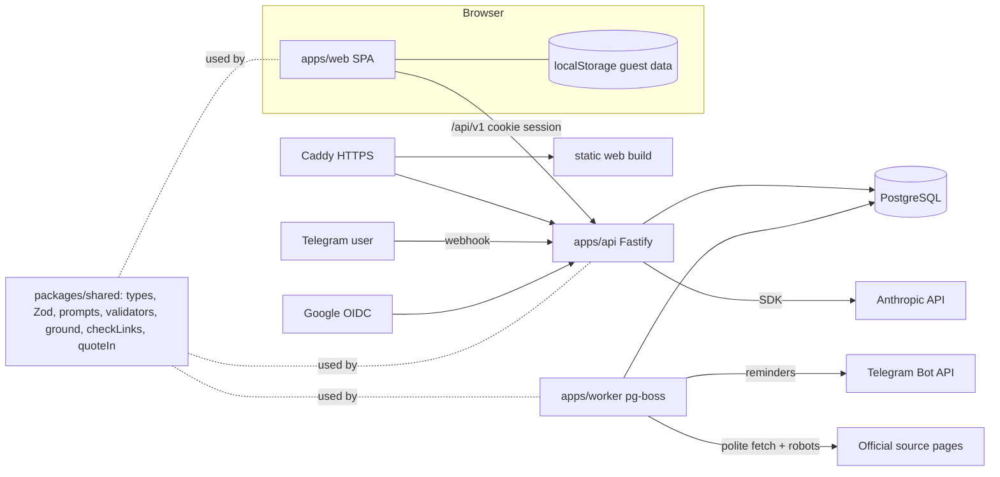
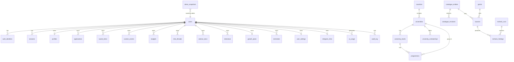

# EduBridge v2 — Architecture (Phase 0)

Status: proposal for owner approval. Source of requirements: `docs/TZ_v2.txt`.

## 1. Situation
No original source is available, only the minified bundle (see PROGRESS.md).
The frontend is therefore a **rewrite** guided by the docs and the bundle's
behaviour; the catalogue **data** is recovered from the bundle and imported
into PostgreSQL. All Part C honesty rules are enforced by new tests.

## 2. Decisions

| Topic | Decision | Reason |
|---|---|---|
| Layout | npm workspaces monorepo: `apps/web`, `apps/api`, `apps/worker`, `packages/shared`, `infra` | No legacy root to preserve, so the "keep web at root" fallback is not needed. |
| API | Node 22, Fastify 5, TypeScript strict, Zod, Prisma, PostgreSQL 16 | Owner choice; shared TS types. |
| Queue | **pg-boss** (Postgres-backed) | No Redis to run; volume is tiny (monthly recheck + reminders). Revisit only if > ~50 jobs/s. |
| Auth | Telegram Login Widget (HMAC) + Google OIDC (PKCE); opaque server sessions in httpOnly cookies | No passwords stored; matches target users. |
| AI | Server proxy to Anthropic (`@anthropic-ai/sdk`), SSE for chat; mock client in tests | Owner/ToR default. claude.ai runtime kept as flagged fallback in the single-file build. |
| Frontend | React 18, TS, Vite 5, Tailwind (RGB CSS-variable tokens, light/dark), lucide-react, hash routing, tx/ru.json i18n | Reproduces the documented stack. |
| Tests | Vitest (all packages) + Playwright E2E; Postgres via docker service | One runner everywhere. |
| PDF summary | **Client-side** (print CSS + html2canvas/jsPDF-class lib with an embedded font covering Uzbek ‘ ʻ and Cyrillic) | No personal data leaves the device. Server render only if client output fails the Uzbek-character test (Phase 4). |
| Hosting | Docker Compose: caddy, web (static), api, worker, postgres, backup | Owner choice. |
| Doc parsing | pdf.js + mammoth **bundled** (lazy chunks), not jsDelivr | Removes CDN dependency (ToR F5). |

## 3. Component diagram

## 4. Data flow rules
1. **Catalogue**: admin edits create `catalogue_revisions` (draft) -> review -> publish. Public API reads only `status=published`. Web ships a **dated snapshot** (generated from the DB at build time) used when the API is unreachable and in the claude.ai single-file build; it is labelled "snapshot <date>".
2. **Student data**: guest = localStorage (same `edubridge:v1` shape); signed-in = API as source of truth with a local cache, optimistic concurrency (`version`, 409 on stale), `POST /me/import-local` on first sign-in.
3. **AI**: browser -> `/ai/*` -> server builds grounded context (<= 20 records from DB), applies `minimalProfile`, calls model, validates (Zod), runs `checkLinks`/`quoteIn`, returns `{result, flags}`. Malformed -> `502 ai_bad_reply`.
4. **Recheck**: worker fetches sources, writes `recheck_findings`; humans accept -> draft revision. Never auto-publish.

## 5. ER diagram

Design notes
- Catalogue tables hold the **published** row; every change goes through `catalogue_revisions` (jsonb snapshot + author + status + reviewer). `version` increments on publish and feeds `GET /catalog/version`.
- Student jsonb columns keep the original frontend shapes -> straight copy from localStorage; validated by Zod in `packages/shared`.
- `sources` is normalised: one row per (entity, field, url) with last check/hash/http status — this is what the recheck job iterates.
- `demo_snapshots(id, kind, title, payload jsonb, saved_at, saved_by)` — server-side saved demo analyses (F12).
- Hard delete: `ON DELETE CASCADE` from `users` to all student tables; `audit_log.actor_id` is set NULL on delete.

## 6. API surface (see `docs/openapi.yaml`)
`/auth/*`, `/me` + `/me/{profile,applications,documents,chats,interviews,growth,budgets,events,saved,settings}`, `/me/import-local`, `/me/export`, `/me/calendar.ics` + signed feed, `/ai/{chat,json,ocr,health}`, `/catalog/*`, `/admin/*` (catalogue editor, revisions, users, usage, audit, recheck, demo snapshots), `/telegram/webhook`, `/health`, `/ready`.
Conventions: `/api/v1`, Zod in/out, error `{error:{code,message,details?}}`, `x-request-id`, cursor pagination, ETag on catalogue.

## 7. Security model
See `docs/THREAT_MODEL.md`. Key points: server-side roles, deny-by-default policy functions, every `/me` query scoped by session user id, CSRF double-submit token, strict CSP, per-IP and per-user rate limits, AI budget cap, SSRF-safe fetcher, no prompt/document text in logs.

## 8. Frontend plan
Routes reproduced from the docs (hash routing): home, signin, demo, onboarding, dashboard, countries, country--XX, universities (finder/advanced), uni--id, unicompare, scholarships, plans, calendar, budget, compare, documents, writing, adviser, assistant (+docs/interview/report), glossary, roadmap, info--*, settings, admin. Persistence adapter (guest/local vs API). `AdminGate` becomes a UX hint; the server enforces roles. Language bundles load on demand to hit the <= 2 MB initial JS target.

## 9. What must be rebuilt from scratch (no source)
Everything in the web app, prompts/validators, matching, roadmap, budget, deadlines, essay feedback, rule-based assistant, profile-builder (36 ideas x 3 languages), glossary (9 terms), document guides, demo personas. Recoverable assets: catalogue data, Russian dictionary (`ru.json` map), some UI strings and probably the 36 ideas' text — to be mined from the bundle in Phase 1/2 where useful. Anything I cannot recover I rewrite and **flag as new text for the owner to review**; I will not present rewritten wording as the original.

## 10. Estimates (focused engineering days, one developer)
| Phase | Scope | Days |
|---|---|---|
| 1 | Monorepo, API foundation, DB, import, catalogue API, web shell + catalogue pages, i18n, landing counters | 8-10 |
| 2 | Auth, sync, AI proxy + ported prompts/validators, AI UI (ask/docs/improve/interview/report), profile builder | 12-15 |
| 3 | Admin CMS, revisions, audit, dashboards, demo mode/snapshots | 6-8 |
| 4 | .ics, worker, Telegram bot, summary export | 5-6 |
| 5 | Recheck, gap tooling, prod infra, backups, load/security pass, legacy retirement | 5-6 |
| 6 | Programme-level model + UI | 4-5 |

## 11. Blocking questions for the owner
1. **Hackathon date / demo length / judging criteria** — decides whether Phase 3 demo mode is brought forward.
2. **Domain + VPS region** — only needed at Phase 5; development uses localhost Docker.
3. **Legacy scholarships** — the two `demo-*` records are fake samples; Chevening, MEXT, El-Yurt Umidi, Erasmus Mundus, TUM, HWUM are real but outside the "7 national grants". Keep as secondary "other scholarships" or drop?
4. **Google email** — store or discard after sign-in?
5. **AI budget cap + default per-user daily quota** (defaults proposed: USD 50/month global, 20 AI requests/user/day).
6. **Pacing inside Phase 1** — it is large; proposed to report after 1a (backend foundation + data import + catalogue API) and 1b (web shell + catalogue pages) if you want smaller checkpoints.
